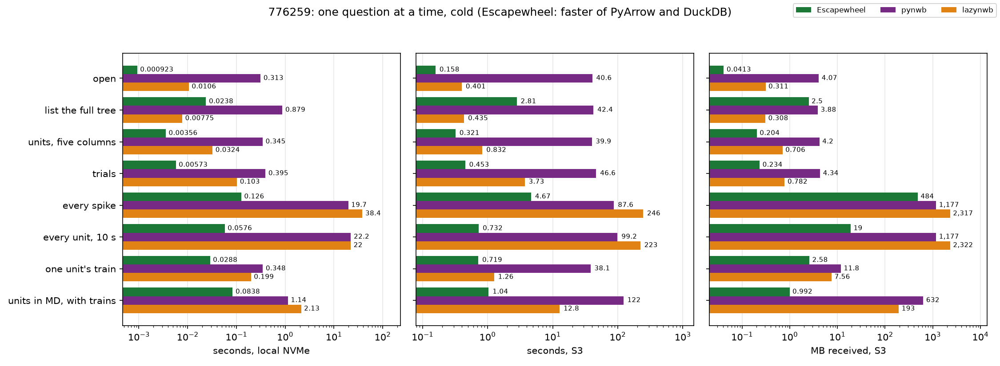
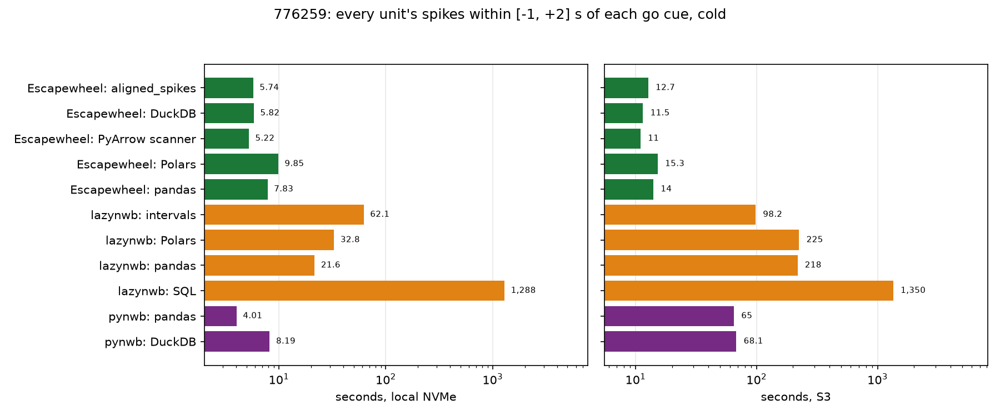
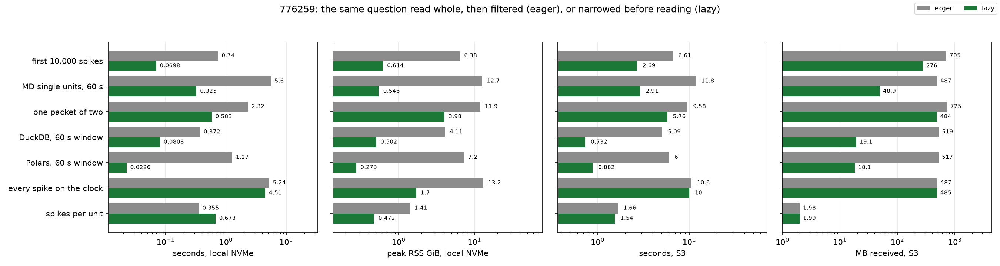

# Escapewheel answers session queries faster than NWB-Zarr

Escapewheel stores a recording session as a packet: Parquet tables and Zarr arrays under a JSON
manifest, built from the session's NWB. This page times common questions asked of two sessions in
both forms, Escapewheel through `escapewheel-reader` and NWB-Zarr through pynwb 4.2.0 and lazynwb
1.0.0.dev5, each arm written as its library's users would write it. Escapewheel answers every
question faster than either NWB reader but two: lazynwb lists the full object tree faster, and from
local disk pynwb aligns every spike to the go cues faster. Over S3 Escapewheel fetches only what a
question needs: 19 MB for every unit's spikes in a ten-second window, where pynwb fetches 1,177 MB
and lazynwb 2,322 MB.

Each reading is in a JSON file in [`results/`](results/), and
[`results/history.md`](results/history.md) records how it was taken.

## Two sessions, read cold from NVMe and from S3

| session | units | spikes | Escapewheel | NWB-Zarr |
|---|---|---|---|---|
| `ecephys_776259`, twelve probes | 6,781 | 286,896,563 | 1.22 GB | 8.49 GB |
| `ecephys_786867` | 4,505 | 131,396,535 | 0.60 GB | 4.74 GB |

Both packets are at core 0.18.0. Escapewheel holds each spike twice. `core.spike_events` holds the
spikes as recorded, sorted by unit, on each probe's own clock. `analysis.spike_events` holds them
already mapped to the session's reference clock, laid out by time bucket and then unit.

The host is an i9-12900K with 24 threads and 126 GiB. "NVMe" is a WD SN850X under btrfs, read cold:
each cell runs in a fresh process after its files are evicted from the page cache, and `mincore`
confirms the eviction. "S3" is the same files under
`s3://aind-scratch-data/galen.lynch/nwb-lake-bench/r164/` in us-west-2, read unsigned from an
on-premises workstation over a 1 Gbit/s link; each S3 cell records the bytes the host received.
A cell is the median of three runs, except the two marked *, which are one run each. Peak memory
is that process's RSS.

An **arm** is one way of answering a question: a reader, and for Escapewheel a path through it.
`Packet.table` and the accessors read through PyArrow, and `Packet.sql` through DuckDB. "Before" is
the PyArrow path at `fa060640`, before the reader read lazily and before the changes listed at the
end. MD is the mediodorsal nucleus of the thalamus, one region label in the electrode coordinates.

The Escapewheel readings were taken on 2026-10-03 at `escapewheel-reader` commits from `c69f7e68`
to `b3843f9d`, with the cells each later commit changes rerun at it, and every cell whose arm was
since rewritten rerun on 2026-10-03. The NWB readings are from 2026-10-02 and 2026-10-03. Every run used DuckDB 1.5.6, PyArrow 25.0.1 and Polars 1.44.2.

## Over S3, Escapewheel wins every question but listing the full tree

The fastest Escapewheel arm for each question on 776259, the larger session. Seconds, with megabytes
received from S3 in parentheses:

| question | Escapewheel, S3 | pynwb, S3 | lazynwb, S3 | Escapewheel, NVMe | pynwb, NVMe | lazynwb, NVMe |
|---|---|---|---|---|---|---|
| open | 0.16 (0.0) | 40.6 (4) | 0.40 (0.3) | 0.001 | 0.31 | 0.011 |
| list the full object tree | 2.77 (3) | 42.4 (4) | 0.44 (0.3) | 0.024 | 0.88 | 0.008 |
| units, five columns | 0.32 (0.2) | 39.9 (4) | 0.83 (0.7) | 0.004 | 0.35 | 0.032 |
| trials | 0.45 (0.2) | 46.6 (4) | 3.73 (0.8) | 0.006 | 0.39 | 0.10 |
| every spike | 4.67 (484) | 87.6 (1,177) | 246 (2,317) | 0.13 | 19.7 | 38.4 |
| every unit's spikes in 10 s | 0.73 (19) | 99.2 (1,177) | 223 (2,322) | 0.058 | 22.2 | 22.1 |
| one unit's train | 0.72 (3) | 38.1 (12) | 1.26 (8) | 0.029 | 0.35 | 0.20 |
| the units in MD with their trains | 1.04 (1.0) | 122 (632) | 12.8 (193) | 0.084 | 1.14 | 2.13 |
| first lick after each go cue | 0.41 (0.1) | 45.4 (4) | 0.61 (0.3) | 0.006 | 0.50 | 0.045 |
| every unit's spikes around each go cue | 11.0 (485) | 65.0 (1,179) | 98.2 (1,181) | 5.22 | 4.01 | 21.6 |

pynwb takes about 40 s to open either NWB from S3, against 0.3 s locally, before any question is
asked. From the NVMe it aligns spikes to go cues in 4.0 s against Escapewheel's 5.2 s; the last
section explains the gap.

Each bar is a cold median on a log axis; Escapewheel's is the faster of its PyArrow and DuckDB arms.
`figures/` holds the same three figures for 786867, and `figures.py` redraws them from `results/`.

## DuckDB reads Escapewheel's spike trains fastest, PyArrow its metadata

`readers.py` asks each question once per reader. Locally, in seconds:

| session | operation | Escapewheel, PyArrow, before | Escapewheel, PyArrow | Escapewheel, DuckDB | pynwb | lazynwb |
|---|---|---|---|---|---|---|
| 776259 | open | 0.001 | 0.001 | 0.014 | 0.31 | 0.011 |
| 776259 | units, five columns | 0.004 | 0.004 | 0.016 | 0.35 | 0.032 |
| 776259 | units, all metadata | 0.007 | 0.007 | 0.030 | 0.43 | 0.12 |
| 776259 | trials | 0.006 | 0.006 | 0.026 | 0.39 | 0.10 |
| 776259 | every spike | 0.72 | 0.65 | 0.13 | 19.67 | 38.35 |
| 776259 | 10 s window | 0.057 | 0.058 | 0.058 | 22.23 | 22.05 |
| 776259 | 10 s window through `spike_times` | 124.52 | 0.12 | 0.058 | 22.23† | 22.05† |
| 776259 | one train | 0.19 | 0.055 | 0.029 | 0.35 | 0.20 |
| 776259 | one train, stored clock | 0.068 | 0.034 | 0.028 | 0.35† | 0.20† |
| 776259 | units in MD with their trains | 0.25 | 0.16 | 0.084 | 1.14 | 2.13 |
| 786867 | open | 0.001 | 0.001 | 0.014 | 0.32 | 0.010 |
| 786867 | units, five columns | 0.003 | 0.003 | 0.015 | 0.33 | 0.032 |
| 786867 | units, all metadata | 0.006 | 0.006 | 0.029 | 0.37 | 0.11 |
| 786867 | trials | 0.005 | 0.006 | 0.026 | 0.37 | 0.10 |
| 786867 | every spike | 0.34 | 0.31 | 0.073 | 0.67 | 8.70 |
| 786867 | 10 s window | 0.042 | 0.046 | 0.038 | 0.77 | 9.05 |
| 786867 | 10 s window through `spike_times` | 56.02 | 0.075 | 0.038 | 0.77† | 9.05† |
| 786867 | one train | 0.079 | 0.032 | 0.023 | 0.33 | 0.093 |
| 786867 | one train, stored clock | 0.032 | 0.022 | 0.023 | 0.33† | 0.093† |
| 786867 | units in MD with their trains | 0.14 | 0.048 | 0.045 | 0.61 | 0.41 |

† pynwb and lazynwb have no `spike_times` route or stored-clock variant, so these rows repeat their
window and train cells.

From S3, in seconds, then megabytes received:

| session | operation | Escapewheel, PyArrow, before | Escapewheel, PyArrow | Escapewheel, DuckDB | pynwb | lazynwb |
|---|---|---|---|---|---|---|
| 776259 | open | 0.18 (0.0 MB) | 0.16 (0.0 MB) | 0.51 (0.1 MB) | 40.62 (4 MB) | 0.40 (0.3 MB) |
| 776259 | units, five columns | 0.34 (0.2 MB) | 0.32 (0.2 MB) | 0.56 (0.1 MB) | 39.91 (4 MB) | 0.83 (0.7 MB) |
| 776259 | units, all metadata | 0.56 (1.0 MB) | 0.47 (1.0 MB) | 0.90 (0.8 MB) | 44.16 (8 MB) | 3.97 (4 MB) |
| 776259 | trials | 0.50 (0.2 MB) | 0.45 (0.2 MB) | 0.84 (0.2 MB) | 46.63 (4 MB) | 3.73 (0.8 MB) |
| 776259 | every spike | 10.77 (483 MB) | 5.25 (483 MB) | 4.67 (484 MB) | 87.59 (1,177 MB) | 246.20 (2,317 MB) |
| 776259 | 10 s window | 0.78 (19 MB) | 0.73 (19 MB) | 0.99 (18 MB) | 99.24 (1,177 MB) | 223.00 (2,322 MB) |
| 776259 | 10 s window through `spike_times` | 134.04 (485 MB) | 1.15 (19 MB) | 0.88 (18 MB) | 99.24 (1,177 MB)† | 223.00 (2,322 MB)† |
| 776259 | one train | 1.59 (3 MB) | 1.18 (10 MB) | 0.72 (3 MB) | 38.11 (12 MB) | 1.26 (8 MB) |
| 776259 | one train, stored clock | 0.99 (3 MB) | 0.97 (3 MB) | 0.75 (3 MB) | 38.11 (12 MB)† | 1.26 (8 MB)† |
| 776259 | units in MD with their trains | 4.75 (2 MB) | 1.04 (1.0 MB) | 1.23 (0.9 MB) | 122.18 (632 MB) | 12.80 (193 MB) |
| 786867 | open | 0.17 (0.0 MB) | 0.15 (0.0 MB) | 0.52 (0.1 MB) | 40.30 (4 MB) | 0.40 (0.3 MB) |
| 786867 | units, five columns | 0.35 (0.2 MB) | 0.33 (0.2 MB) | 0.61 (0.1 MB) | 38.65 (4 MB) | 0.84 (0.7 MB) |
| 786867 | units, all metadata | 0.52 (0.8 MB) | 0.45 (0.8 MB) | 0.84 (0.6 MB) | 43.77 (6 MB) | 4.12 (2 MB) |
| 786867 | trials | 0.48 (0.2 MB) | 0.46 (0.2 MB) | 0.83 (0.2 MB) | 47.04 (4 MB) | 3.82 (0.7 MB) |
| 786867 | every spike | 5.38 (240 MB) | 2.82 (240 MB) | 2.67 (240 MB) | 74.91 (560 MB) | 118.81 (625 MB) |
| 786867 | 10 s window | 0.88 (19 MB) | 0.69 (19 MB) | 0.94 (19 MB) | 44.17 (559 MB) | 114.04 (607 MB) |
| 786867 | 10 s window through `spike_times` | 63.03 (240 MB) | 1.13 (19 MB) | 1.01 (19 MB) | 44.17 (559 MB)† | 114.04 (607 MB)† |
| 786867 | one train | 1.41 (2 MB) | 1.12 (6 MB) | 0.65 (2 MB) | 36.31 (7 MB) | 0.92 (4 MB) |
| 786867 | one train, stored clock | 0.90 (2 MB) | 0.96 (2 MB) | 0.65 (2 MB) | 36.31 (7 MB)† | 0.92 (4 MB)† |
| 786867 | units in MD with their trains | 2.66 (1 MB) | 0.68 (0.4 MB) | 1.09 (0.6 MB) | 61.25 (182 MB) | 2.19 (27 MB) |

The readers agree on every count but two. On 786867 the ten-second window holds two more spikes in
Escapewheel than in the NWB, which rounds the window's edges to its own float times. On the units
in MD, Escapewheel counts a unit with any electrode in the region, 466 and 164 units; the NWBs give
409 and 140.

## Escapewheel aligns spikes to go cues fastest over S3, pynwb from local disk

`trials.py` asks two questions of the trials. Lick latency is the first lick after each go cue and
before the next. Go-cue spikes are every unit's spikes within [-1, +2] s of each go cue. Each store's
arms load the columns they use into pandas, scan them through Polars or a PyArrow scanner, state the
question in SQL, or call a reader's own helper: `aligned_spikes` for Escapewheel, interval reads for
lazynwb. The pandas and scanner arms share one NumPy analysis, which searches each unit's sorted
train for every cue's window. Lick latency, in seconds:

| arm | 776259, NVMe | 776259, S3 | 786867, NVMe | 786867, S3 |
|---|---|---|---|---|
| Escapewheel, pandas | 0.017 | 1.67 (0.4 MB) | 0.016 | 1.74 (0.3 MB) |
| Escapewheel, scanner | 0.006 | 0.61 (0.2 MB) | 0.006 | 0.58 (0.2 MB) |
| Escapewheel, polars | 0.009 | 0.41 (0.1 MB) | 0.009 | 0.40 (0.1 MB) |
| Escapewheel, duckdb | 0.024 | 0.78 (0.2 MB) | 0.025 | 0.89 (0.2 MB) |
| pynwb, pandas | 0.50 | 46.80 (4 MB) | 0.70 | 44.51 (4 MB) |
| pynwb, duckdb | 0.88 | 45.37 (4 MB) | 0.65 | 44.46 (4 MB) |
| lazynwb, pandas | 0.24 | 4.24 (0.8 MB) | 0.21 | 4.20 (0.8 MB) |
| lazynwb, polars | 0.045 | 0.61 (0.3 MB) | 0.047 | 0.60 (0.3 MB) |
| lazynwb, sql | 0.12 | 1.21 (0.4 MB) | 0.26 | 1.39 (0.4 MB) |

Go-cue spikes, in seconds, then peak RSS locally and megabytes received from S3:

| arm | 776259, NVMe | 776259, S3 | 786867, NVMe | 786867, S3 |
|---|---|---|---|---|
| Escapewheel, pandas | 7.83 (15.3 GiB) | 14.04 (485 MB) | 3.55 (8.2 GiB) | 7.54 (241 MB) |
| Escapewheel, scanner | 5.22 (1.6 GiB) | 11.00 (485 MB) | 2.44 (1.3 GiB) | 5.73 (240 MB) |
| Escapewheel, polars | 9.85 (7.7 GiB) | 15.26 (516 MB) | 4.35 (3.6 GiB) | 7.47 (257 MB) |
| Escapewheel, duckdb | 5.82 (20.9 GiB) | 11.53 (518 MB) | 2.57 (9.7 GiB) | 5.97 (258 MB) |
| Escapewheel, aligned_spikes | 5.74 (16.5 GiB) | 12.74 (523 MB) | 2.49 (7.7 GiB) | 7.51 (262 MB) |
| pynwb, pandas | 4.01 (8.8 GiB) | 65.04 (1,179 MB) | 2.17 (4.1 GiB) | 54.33 (561 MB) |
| pynwb, duckdb | 8.19 (27.3 GiB) | 68.07 (1,179 MB) | 3.74 (12.6 GiB) | 55.84 (560 MB) |
| lazynwb, pandas | 21.55 (13.1 GiB) | 218.07 (2,435 MB) | 10.41 (6.1 GiB) | 109.20 (604 MB) |
| lazynwb, polars | 32.79 (17.4 GiB) | 224.85 (2,349 MB) | 13.50 (8.1 GiB) | 112.55 (622 MB) |
| lazynwb, sql | 1,287.96 (63.6 GiB) | 1,350.36* (2,362 MB) | 249.29 (29.8 GiB) | 406.59* (624 MB) |
| lazynwb, intervals | 62.14 (17.4 GiB) | 98.19 (1,181 MB) | 27.17 (8.4 GiB) | 58.55 (562 MB) |

Both pynwb arms read the ragged spike column whole, as its flat times and the index ending each
unit's run. Through `units.to_dataframe()`, which reads each unit's train as its own slice, the
pandas arm took 1,938 s from S3 on 776259 and fetched 1,852 MB. pynwb's DuckDB arm, like
Escapewheel's, takes DuckDB's ASOF join where no spike can fall in two windows; the range join took
78 s on the NVMe on 776259, against 8.2 s.

Every arm agrees on lick latency. On go-cue spikes the Escapewheel arms that compare integer ticks
find 99,453,482 pairs on 776259 and 45,723,853 on 786867. The pandas arms compare float seconds and
find one fewer on 786867, where a spike lies exactly 31,250 ticks before a cue. The NWB arms find
99,452,477 and 45,723,415: the NWB's spike times differ from Escapewheel's mapped ticks by up to
0.6 ms, and about half the spikes on a window's edge tick fall outside it. `results/history.md`
accounts for both differences spike by spike.

## Over S3, Escapewheel lists its tables in 0.3 s and its full tree in 2.8 s

"List tables" names the tables a store holds; "full tree" also gives each table's columns and types.
pynwb reaches its tables only by building the whole tree, so both of its rows time reading the file
with `NWBZarrV2IO`. In seconds, then megabytes received:

| session | operation | store | Escapewheel, PyArrow | Escapewheel, DuckDB | pynwb | lazynwb |
|---|---|---|---|---|---|---|
| 776259 | list tables | NVMe | 0.003 | 0.003 | 0.88 | 0.009 |
| 776259 | full tree | NVMe | 0.024 | 0.023 | 0.88 | 0.008 |
| 776259 | list tables | S3 | 0.30 (0.1 MB) | 0.30 (0.1 MB) | 42.76 (4 MB) | 0.44 (0.3 MB) |
| 776259 | full tree | S3 | 2.77 (3 MB) | 2.84 (3 MB) | 42.36 (4 MB) | 0.44 (0.3 MB) |
| 786867 | list tables | NVMe | 0.003 | 0.003 | 0.53 | 0.006 |
| 786867 | full tree | NVMe | 0.017 | 0.017 | 0.67 | 0.008 |
| 786867 | list tables | S3 | 0.30 (0.1 MB) | 0.33 (0.1 MB) | 41.95 (4 MB) | 0.42 (0.3 MB) |
| 786867 | full tree | S3 | 2.76 (2 MB) | 2.71 (2 MB) | 38.15 (4 MB) | 0.44 (0.3 MB) |

## Lazy reading pays where row-group statistics can skip data

`lazy.py` answers each question twice from the same packet. The eager arm reads each table whole and
filters it in memory. The lazy arm narrows the scan first, through `Packet.scanner`, `where`,
`tick_range` and the streaming forms of `on_clock` and `seconds`. In seconds, then peak RSS locally
and megabytes received from S3:

| operation | store | session | eager | lazy |
|---|---|---|---|---|
| first rows | NVMe | 776259 | 0.74 (6.4 GiB) | 0.070 (0.6 GiB) |
| spikes per unit | NVMe | 776259 | 0.36 (1.4 GiB) | 0.67 (0.5 GiB) |
| rate on clock | NVMe | 776259 | 5.24 (13.2 GiB) | 4.51 (1.7 GiB) |
| good region window | NVMe | 776259 | 5.60 (12.7 GiB) | 0.33 (0.5 GiB) |
| one session | NVMe | 776259 | 2.32 (11.9 GiB) | 0.58 (4.0 GiB) |
| duckdb window | NVMe | 776259 | 0.37 (4.1 GiB) | 0.081 (0.5 GiB) |
| polars window | NVMe | 776259 | 1.27 (7.2 GiB) | 0.023 (0.3 GiB) |
| first rows | S3 | 776259 | 6.61 (705 MB) | 2.69 (276 MB) |
| spikes per unit | S3 | 776259 | 1.66 (2 MB) | 1.54 (2 MB) |
| rate on clock | S3 | 776259 | 10.56 (487 MB) | 10.02 (485 MB) |
| good region window | S3 | 776259 | 11.79 (487 MB) | 2.91 (49 MB) |
| one session | S3 | 776259 | 9.58 (725 MB) | 5.76 (484 MB) |
| duckdb window | S3 | 776259 | 5.09 (519 MB) | 0.73 (19 MB) |
| polars window | S3 | 776259 | 6.00 (517 MB) | 0.88 (18 MB) |
| first rows | NVMe | 786867 | 0.37 (3.1 GiB) | 0.064 (0.6 GiB) |
| spikes per unit | NVMe | 786867 | 0.17 (0.8 GiB) | 0.32 (0.4 GiB) |
| rate on clock | NVMe | 786867 | 2.45 (6.7 GiB) | 2.10 (1.5 GiB) |
| good region window | NVMe | 786867 | 2.55 (6.1 GiB) | 0.14 (0.4 GiB) |
| one session | NVMe | 786867 | 1.92 (10.4 GiB) | 0.29 (2.0 GiB) |
| duckdb window | NVMe | 786867 | 0.21 (2.1 GiB) | 0.061 (0.5 GiB) |
| polars window | NVMe | 786867 | 0.64 (3.5 GiB) | 0.026 (0.3 GiB) |
| first rows | S3 | 786867 | 3.90 (361 MB) | 2.64 (280 MB) |
| spikes per unit | S3 | 786867 | 0.96 (0.9 MB) | 0.95 (0.9 MB) |
| rate on clock | S3 | 786867 | 5.64 (241 MB) | 5.32 (241 MB) |
| good region window | S3 | 786867 | 6.64 (241 MB) | 2.55 (14 MB) |
| one session | S3 | 786867 | 9.17 (728 MB) | 3.27 (240 MB) |
| duckdb window | S3 | 786867 | 3.44 (257 MB) | 0.72 (19 MB) |
| polars window | S3 | 786867 | 3.49 (257 MB) | 0.82 (19 MB) |

- **first rows**: the first 10,000 spikes, in seconds on the reference clock.
- **spikes per unit**: a count per unit, which reads one column either way.
- **rate on clock**: every spike's whole second on the reference clock.
- **good region window**: the spikes of MD's single units between 100 and 160 s, with the units
  chosen inside the timed read: 111 units and 59,650 spikes on 776259, and 71 units and 34,593 spikes
  on 786867.
- **one session**: one packet's spikes out of a `PacketSet` of both sessions.
- **duckdb window** and **polars window**: a count per unit in the same 60 s window from
  `analysis.spike_events`, from a table read whole against `Packet.scan` for DuckDB and
  `TableResource.scan_polars` for Polars.

A window from `analysis.spike_events`, which is sorted by time, fetches 19 MB from S3 lazily instead
of 519 MB. A question over every row costs about the same either way: lazy reading cuts the memory
of `rate on clock` from 13.2 GiB to 1.7 GiB but fetches the same bytes. Locally, `spikes per unit`
is slower lazily, because the eager arm reads its one column in a single pass.

## Five reader changes cut these times without changing an answer

- **PyArrow fetches a row group's byte ranges at once.** The reader's Parquet format pre-buffers
  with an eager cache (`pa.CacheOptions(lazy=False)`). From S3, every spike went from 10.8 s to
  5.25 s on 776259 and the units in MD from 4.75 s to 1.85 s, for the same bytes.
- **`spike_times` reads `analysis.spike_events`.** A ten-second window through `spike_times` mapped
  every spike before the lazy reader, and took 134 s from S3; it now takes 1.15 s. The analysis table
  beats the core table and its clock mapping for every selection measured over S3, from one unit to
  all 6,781. On the NVMe it beats it for every selection but a single unit, where the core table is
  0.02 s faster.
- **`aligned_spikes` skips a clock query and a join key.** It reads the spikes' clock from row-group
  statistics instead of querying every row group, and joins on the session only when the packet
  holds several. Go-cue spikes from S3 went from 27.4 s to 12.7 s on 776259.
- **`PacketSet.table` returns only the columns named.** Stamping a session name on 418 million rows
  cost 2.5 s, and a two-session read went from 4.3 s to 0.84 s.
- **A long membership test is guarded with ranges.** PyArrow checks an `is_in` filter against
  row-group statistics only when it holds at most 50 values. `where` now adds up to eight value
  ranges beside a longer one, cut at its widest gaps, so the 111 units of `good region window` read
  27 of 293 row groups. From S3 that fetches 49 MB instead of 475 MB, in 2.91 s instead of 7.05 s.

## Five gaps remain

- **Listing the full tree over S3** takes Escapewheel 2.8 s against lazynwb's 0.44 s. The listing
  opens each table's Parquet footer for its schema, 58 requests; lazynwb gets its tree in 0.3 MB.
- **The first rows over S3** fetch 276 MB lazily for 10,000 rows. The scanner reads ahead up to 16
  batches of every column before `head` stops, and the eager cache fetches each in full. A smaller
  readahead would help `head` and slow a full scan.
- **One unit's train through PyArrow** fetches 10 MB from S3 on 776259 where DuckDB fetches 3,
  because the eager cache takes the row group's whole column chunks.
- **`aligned_spikes` over S3** takes 1.2 to 1.5 s longer than the same question stated in DuckDB,
  for the same bytes.
- **Escapewheel's unit-sorted spikes are on each probe's clock.** A per-unit analysis reads
  `core.spike_events` and maps every spike onto the reference clock: on 776259, mapping all 287
  million spikes takes 3.8 s of compute, and the scanner arm takes 5.2 s from the NVMe in all.
  pynwb stores its times already mapped and sorted by unit, and aligns the go cues in 4.0 s.
  `analysis.spike_events` holds the mapped ticks, but laid out by time bucket, so a unit's train is
  split across every bucket.
