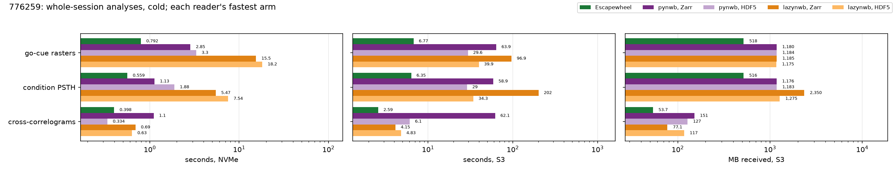

# Escapewheel answers session queries faster than NWB, from disk and from S3

Escapewheel stores a recording session as a packet: Parquet tables and Zarr arrays under a JSON
manifest, built from the session's NWB. This page times the questions an analyst asks of two
sessions, stored three ways: as an Escapewheel packet, read through `escapewheel-reader`; as the
NWB-Zarr the sessions are published in; and as an NWB-HDF5 converted from it. pynwb 4.2.0 and
lazynwb 1.0.0.dev5 read both NWB formats. Each reader is driven the way its library's users would
drive it.

Escapewheel answers every question fastest but three. lazynwb lists an NWB-HDF5's tables and full
tree faster from S3, and an NWB-Zarr's full tree faster from the NVMe. pynwb on the NWB-HDF5 gathers
spike trains for a cross-correlogram 0.07 s faster from the NVMe. From S3, Escapewheel fetches what
a question needs and little else: 19 MB for every unit's spikes in a ten-second window, where pynwb
fetches 1,177 MB.

Each reading is in a JSON file in [`results/`](results/), and
[`results/history.md`](results/history.md) records how it was taken.

## Two sessions, three stores, read cold from NVMe and from S3

| session | units | spikes | Escapewheel | NWB-Zarr | NWB-HDF5 |
|---|---|---|---|---|---|
| `ecephys_776259`, twelve probes | 6,781 | 286,896,563 | 1.22 GB, 55 objects | 8.49 GB, 6,519 objects | 9.01 GB, one file |
| `ecephys_786867` | 4,505 | 131,396,535 | 0.60 GB, 53 objects | 4.74 GB, 4,809 objects | 5.09 GB, one file |

Both packets are at core 0.18.0. Escapewheel holds each spike twice. `core.spike_events` holds the
spikes as recorded, sorted by unit, on each probe's own clock. `analysis.spike_events` holds them
mapped to the session's reference clock, laid out by time bucket and then unit.

The NWB-HDF5 is `to_hdf5.py`'s conversion of the NWB-Zarr: pynwb exports it unchanged, and
`h5repack` compresses every dataset with shuffle and gzip at level 4. HDF5 cannot read the
NWB-Zarr's Blosc, so its layout is one this page chose: spike times in 524,288-value chunks, where
the NWB-Zarr holds them in 256,634-value chunks.

The host is an i9-12900K with 24 threads and 126 GiB. "NVMe" is a WD SN850X under btrfs, read
cold: each cell runs in a fresh process after its files are evicted from the page cache, and
`mincore` confirms the eviction. "S3" is the same files under
`s3://aind-scratch-data/galen.lynch/nwb-lake-bench/r164/` in us-west-2, read unsigned from an
on-premises workstation over a 1 Gbit/s link; each S3 cell records the bytes the host received. A
cell is the median of three runs, except those marked *, which are one run each. Peak memory is
that process's RSS.

An **arm** is one way of answering a question: a reader, a format, and a path through the reader.
Escapewheel's arms read through PyArrow (`Packet.table`, `Packet.scanner` and the accessors),
DuckDB (`Packet.sql`) or Polars (`scan_polars`). MD is the mediodorsal nucleus of the thalamus, one
region label in the units' CCF coordinates. A **single unit** is one whose quality label is `sua`.

The NWB readings on 2026-10-04 supersede the 2026-10-02 ones from the NVMe, whose slow reads did
not reproduce: pynwb now reads every spike of 776259 in 1.29 s, where it took 19.7 s then. Every run
used DuckDB 1.5.6, PyArrow 25.0.1, Polars 1.44.2 and aind-ephys-utils 0.4.0.

## Each test asks one question and checks its answer

A cell's clock starts before the store is opened and stops when the answer is in memory. Every arm
must return the same answer, which the script checks after the clock stops; the answers are in
the JSON as `value`.

`readers.py` asks the reader questions:

| test | question | answer checked |
|---|---|---|
| open | open the store | its top-level entries |
| list tables | name every table | the names |
| full tree | name every table with its columns and types | the leaves |
| units, five columns | read five columns of every unit | the rows |
| trials | read every trial | the rows |
| every spike | read every spike time | their sum |
| 10 s window | every unit's spikes from 100 to 110 s | the spikes |
| one train | one unit's spike times on the reference clock: unit 1475 of 776259, with 1,789,113 spikes | the spikes |
| units in MD | the units with an electrode in MD, and their spike trains | units and spikes |
| unit positions | every single unit's CCF position and spike count, as a map coloured by activity needs | units, summed coordinates, spikes |
| MD waveforms | the mean waveform of every single unit in MD | units, summed minima in µV |

`trials.py` asks two questions of the trials:

- **Lick latency**: for each trial, the first lick after the go cue and before the next trial's
  cue. The answer is the trials with a lick and the median and mean latency.
- **Go-cue rasters**: what a raster plot of every unit draws. Each spike within [-1, +2] s of a go
  cue is a row of (unit, trial, seconds from the cue), one row per (spike, cue) pair, with each
  unit's rows together and the trials in any order. The answer is 99,453,482 pairs on 776259.

`population.py` asks two population questions:

- **Condition PSTH**: every unit's spikes counted in 50 ms bins over [-1, +2) s around each go
  cue, summed over the trials of each of five conditions: left, right or no response, and for a
  response whether it was rewarded. The answer is the spikes counted and the nonzero (unit,
  condition, bin) cells.
- **Cross-correlograms**: for every pair of single units in MD, 93 units on 776259, the lag from
  each spike of one to each spike of the other, in 0.5 ms bins out to ±10 ms. The answer is the
  spike pairs and the nonzero (pair, bin) cells.

The population arms either answer in an engine (DuckDB or Polars) or hand each unit's spike times
to aind-ephys-utils, whose `from_dataframe` and `psth` compute the PSTH and `ccg_allpairs_sparse`
the correlograms. An aind-ephys-utils cell times only the read into the library's input: the
library's own work does not depend on the store, and takes 32 to 36 s for the PSTH of 776259 and
0.3 s for its correlograms.

## Escapewheel answers fastest from the NVMe

On 776259, the larger session, in seconds. Escapewheel's column is its fastest arm; the NWB columns
are each reader's fastest arm on that format.

| test | Escapewheel | pynwb, Zarr | pynwb, HDF5 | lazynwb, Zarr | lazynwb, HDF5 |
|---|---|---|---|---|---|
| open | 0.001 | 0.60 | 0.19 | 0.010 | 0.035 |
| list tables | 0.003 | 0.64 | 0.19 | 0.009 | 0.022 |
| full tree | 0.033 | 0.64 | 0.19 | 0.008 | 0.025 |
| units, five columns | 0.004 | 0.72 | 0.20 | 0.046 | 0.059 |
| trials | 0.006 | 0.54 | 0.20 | 0.16 | 0.079 |
| every spike | 0.13 | 1.29 | 1.99 | 18.3 | 19.9 |
| 10 s window | 0.053 | 1.54 | 2.16 | 18.6 | 20.2 |
| one train | 0.028 | 0.68 | 0.21 | 0.24 | 0.25 |
| units in MD | 0.084 | 3.48 | 0.51 | 2.25 | 2.28 |
| unit positions | 0.009 | 0.61 | 0.20 | 0.12 | 0.086 |
| MD waveforms | 0.12 | 1.02 | 0.42 | 0.32 | 0.33 |
| go-cue rasters | 0.79 | 2.85 | 3.30 | 15.5 | 18.2 |
| condition PSTH | 0.56 | 1.13 | 1.88 | 5.47 | 7.54 |
| cross-correlograms | 0.40 | 1.10 | 0.33 | 0.69 | 0.63 |

lazynwb lists the NWB-Zarr's full tree in 0.008 s against Escapewheel's 0.033, which opens every
table's Parquet footer for its columns. pynwb on the NWB-HDF5 hands the MD units' trains to
aind-ephys-utils in 0.33 s against 0.40. On 786867 the order is the same, and every Escapewheel
cell is faster than any NWB reader's but the full tree.

## Escapewheel answers fastest from S3, fetching least

On 776259, in seconds, then megabytes received:

| test | Escapewheel | pynwb, Zarr | pynwb, HDF5 | lazynwb, Zarr | lazynwb, HDF5 |
|---|---|---|---|---|---|
| open | 0.16 (0.0) | 40.6 (4) | 2.47 (11) | 0.40 (0.3) | 0.18 (0.0) |
| list tables | 0.29 (0.1) | 42.8 (4) | 2.46 (11) | 0.44 (0.3) | 0.20 (0.0) |
| full tree | 0.51 (3) | 42.4 (4) | 2.36 (11) | 0.44 (0.3) | 0.21 (0.0) |
| units, five columns | 0.32 (0.2) | 39.9 (4) | 2.39 (11) | 0.83 (0.7) | 0.73 (2) |
| trials | 0.45 (0.2) | 46.6 (4) | 2.44 (11) | 3.73 (0.8) | 0.75 (1) |
| every spike | 4.67 (484) | 87.6 (1,177) | 29.2 (1,183) | 246 (2,317) | 43.2 (1,183) |
| 10 s window | 0.73 (19) | 99.2 (1,177) | 27.7 (1,193) | 223 (2,322) | 45.1 (1,173) |
| one train | 0.72 (3) | 38.1 (12) | 2.70 (22) | 1.26 (8) | 1.36 (13) |
| units in MD | 1.04 (1.0) | 122 (632) | 8.99 (278) | 12.8 (193) | 9.32 (268) |
| unit positions | 0.59 (0.3) | 43.6 (4) | 2.40 (11) | 1.33 (0.8) | 0.64 (1) |
| MD waveforms | 1.38 (2) | 44.6 (47) | 3.27 (19) | 2.47 (44) | 1.74 (10) |
| go-cue rasters | 6.77 (518) | 63.9 (1,180) | 29.6 (1,184) | 96.9 (1,185) | 39.9 (1,175) |
| condition PSTH | 6.35 (517) | 58.9 (1,176) | 29.0 (1,183) | 202 (2,350) | 34.3 (1,275) |
| cross-correlograms | 2.59 (54) | 62.1 (152) | 6.10 (127) | 4.15 (77) | 4.83 (117) |

lazynwb lists the NWB-HDF5's tables in 0.20 s and its full tree in 0.21 s, against Escapewheel's
0.29 and 0.51 s.

pynwb takes about 40 s to open the NWB-Zarr from S3 before any question is asked, and 2.5 s to open
the NWB-HDF5. The NWB-Zarr is 6,519 objects, and pynwb builds its whole object tree on opening.
Its consolidated metadata, `.zmetadata`, does not spare that; why has not been measured. Its spike
times are also in twice as many chunks as the NWB-HDF5's, for about the same bytes.

## Escapewheel reads spikes for a trial or population analysis fastest

Seconds for each arm on 776259, then peak RSS from the NVMe and megabytes received from S3. A
Zarr and an HDF5 cell are each NWB arm's.

| arm | rasters, NVMe | rasters, S3 | PSTH, NVMe | PSTH, S3 | correlograms, NVMe | correlograms, S3 |
|---|---|---|---|---|---|---|
| Escapewheel, DuckDB | 0.79 (5.4 GiB) | 8.79 (517) | 0.56 (1.0 GiB) | 8.83 (516) | 0.71 (1.1 GiB) | 2.68 (60) |
| Escapewheel, Polars | 2.85 (8.5 GiB) | 6.85 (514) | 1.75 (3.4 GiB) | 6.35 (517) | 1.35 (2.8 GiB) | 7.43 (517) |
| Escapewheel, PyArrow scanner | 2.68 (7.4 GiB) | 6.77 (518) | | | | |
| Escapewheel, pandas | 3.48 (12.8 GiB) | 9.49 (518) | | | | |
| Escapewheel, `aligned_spikes` | 1.01 (6.6 GiB) | 9.38 (520) | | | | |
| Escapewheel, aind-ephys-utils | | | 2.76 (16.0 GiB) | 8.29 (518) | 0.40 (1.3 GiB) | 2.59 (54) |
| pynwb, pandas, Zarr | 4.37 (9.2 GiB) | 66.6 (1,179) | | | | |
| pynwb, pandas, HDF5 | 4.95 (9.1 GiB) | 30.4 (1,183) | | | | |
| pynwb, DuckDB, Zarr | 2.85 (10.0 GiB) | 63.9 (1,180) | 2.89 (11.0 GiB) | 58.9 (1,176) | 1.99 (1.1 GiB) | 62.7 (152) |
| pynwb, DuckDB, HDF5 | 3.30 (10.1 GiB) | 29.6 (1,184) | 3.23 (10.9 GiB) | 29.0 (1,183) | 1.25 (1.2 GiB) | 6.60 (127) |
| pynwb, aind-ephys-utils, Zarr | | | 1.13 (8.7 GiB) | 59.7 (1,177) | 1.10 (0.5 GiB) | 62.1 (152) |
| pynwb, aind-ephys-utils, HDF5 | | | 1.88 (8.7 GiB) | 29.9 (1,193) | 0.33 (0.5 GiB) | 6.10 (127) |
| lazynwb, pandas, Zarr | 15.5 (23.5 GiB) | 211 (2,434) | | | | |
| lazynwb, pandas, HDF5 | 18.2 (22.0 GiB) | 39.9 (1,175) | | | | |
| lazynwb, Polars, Zarr | 26.9 (17.4 GiB) | 207 (1,304) | 26.3 (17.4 GiB) | 220 (2,350) | 3.95 (2.5 GiB) | 8.95 (307) |
| lazynwb, Polars, HDF5 | 27.0 (17.4 GiB) | 48.6 (1,183) | 28.0 (17.4 GiB) | 54.0 (1,287) | 4.55 (2.4 GiB) | 10.0 (123) |
| lazynwb, Polars SQL, Zarr | 26.2 (25.3 GiB) | 205 (1,307) | | | | |
| lazynwb, Polars SQL, HDF5 | 27.2 (24.5 GiB) | 50.2 (1,185) | | | | |
| lazynwb, intervals, Zarr | 59.1 (17.4 GiB) | 96.9 (1,185) | | | | |
| lazynwb, intervals, HDF5 | 59.6 (18.4 GiB) | 86.2 (1,295) | | | | |
| lazynwb, aind-ephys-utils, Zarr | | | 5.47 (19.0 GiB) | 202 (2,350) | 0.69 (0.8 GiB) | 4.15 (77) |
| lazynwb, aind-ephys-utils, HDF5 | | | 7.54 (19.0 GiB) | 34.3 (1,275) | 0.63 (0.8 GiB) | 4.83 (117) |

"Intervals" is lazynwb's `get_spike_times_in_intervals`, and `aligned_spikes` is the reader's
helper for the same question. An empty cell is an arm the test does not have.

The engine arms join spikes to cues, or to each other, on bins as wide as the window, which turns a
range join into a hash join. They gather Escapewheel's spikes from `analysis.spike_events`, already
on the reference clock; the aind-ephys-utils arm cuts that table into one train per unit with the
reader's `ragged`. Escapewheel's DuckDB PSTH takes 0.56 s from the NVMe, and its aind-ephys-utils
arm 2.76 s, of which the library's input takes most. pynwb's flat spike column gives that input in
1.13 s.

Every arm of one format agrees on each answer. Escapewheel and the NWB disagree in a few spikes per
million, because the NWB's spike times differ from Escapewheel's mapped ticks by up to 0.6 ms:
99,453,482 raster pairs against 99,452,477 on 776259, and 69,411,804 correlogram pairs against
69,374,161. `results/history.md` accounts for the raster pairs spike by spike. Escapewheel's
aind-ephys-utils PSTH differs from its DuckDB PSTH in 0.01% of its cells, because the library
bins float seconds where DuckDB bins integer ticks.

## Copying a store before reading it pays after one to three analyses

`download.py` copies each store from S3 to the NVMe with the AWS CLI (`aws s3 cp`, ten concurrent
requests) and with `s5cmd` (256), and to RAM under `/dev/shm` with `s5cmd`. In seconds, the
faster tool's:

| store | 776259, NVMe | 776259, RAM | 786867, NVMe | 786867, RAM |
|---|---|---|---|---|
| Escapewheel | 11.7 | 11.5 | 6.2 | 6.6 |
| NWB-Zarr, `s5cmd` | 74.0 | 73.2 | 41.3 | 42.1 |
| NWB-Zarr, AWS CLI | 106.6 | | 65.9 | |
| NWB-HDF5 | 79.9 | 81.8 | 46.3 | 46.8 |

Each copy ran at the 1 Gbit/s link's limit, about 110 MB/s, so RAM was no faster than the NVMe, and
the stores' bytes set the times. The AWS CLI copies the NWB-Zarr's 6,519 objects 44% slower than
`s5cmd`; for one large file or 55 objects the two tie.

A copy pays once the seconds it saves on each analysis add up to its own: after
`copy / (S3 − NVMe)` analyses, from the tables above, for 776259:

| store and reader | copy | condition PSTH | go-cue rasters | unit positions |
|---|---|---|---|---|
| Escapewheel | 11.7 s | 2.0 | 2.0 | 20 |
| NWB-Zarr, pynwb | 74.0 s | 1.3 | 1.2 | 1.7 |
| NWB-Zarr, lazynwb | 74.0 s | 0.4 | 0.9 | 61 |
| NWB-HDF5, pynwb | 79.9 s | 2.9 | 3.0 | 36 |

A whole-session analysis repays any copy within three runs; lazynwb's PSTH on the NWB-Zarr repays
it before the first finishes. Reading one table from S3 stays cheaper than copying for 20 or more
questions, except through pynwb on the NWB-Zarr, whose 40 s opening every question pays.

## Lazy reading pays where row-group statistics can skip data

`lazy.py` answers each question twice from the same packet. The eager arm reads each table whole and
filters it in memory. The lazy arm narrows the scan first, through `Packet.scanner`, `where`,
`tick_range` and the streaming forms of `on_clock` and `seconds`. In seconds, then peak RSS locally
and megabytes received from S3:

| operation | store | session | eager | lazy |
|---|---|---|---|---|
| first rows | NVMe | 776259 | 0.74 (6.4 GiB) | 0.070 (0.6 GiB) |
| spikes per unit | NVMe | 776259 | 0.36 (1.4 GiB) | 0.67 (0.5 GiB) |
| rate on clock | NVMe | 776259 | 3.06 (12.4 GiB) | 3.01 (1.6 GiB) |
| good region window | NVMe | 776259 | 5.60 (12.7 GiB) | 0.33 (0.5 GiB) |
| one session | NVMe | 776259 | 2.32 (11.9 GiB) | 0.58 (4.0 GiB) |
| duckdb window | NVMe | 776259 | 0.37 (4.1 GiB) | 0.081 (0.5 GiB) |
| polars window | NVMe | 776259 | 1.27 (7.2 GiB) | 0.023 (0.3 GiB) |
| first rows | S3 | 776259 | 6.61 (705 MB) | 2.69 (276 MB) |
| spikes per unit | S3 | 776259 | 1.66 (2 MB) | 1.54 (2 MB) |
| rate on clock | S3 | 776259 | 8.69 (485 MB) | 8.49 (485 MB) |
| good region window | S3 | 776259 | 11.79 (487 MB) | 2.91 (49 MB) |
| one session | S3 | 776259 | 9.58 (725 MB) | 5.76 (484 MB) |
| duckdb window | S3 | 776259 | 5.09 (519 MB) | 0.73 (19 MB) |
| polars window | S3 | 776259 | 6.00 (517 MB) | 0.88 (18 MB) |
| first rows | NVMe | 786867 | 0.37 (3.1 GiB) | 0.064 (0.6 GiB) |
| spikes per unit | NVMe | 786867 | 0.17 (0.8 GiB) | 0.32 (0.4 GiB) |
| rate on clock | NVMe | 786867 | 1.45 (5.9 GiB) | 1.38 (1.5 GiB) |
| good region window | NVMe | 786867 | 2.55 (6.1 GiB) | 0.14 (0.4 GiB) |
| one session | NVMe | 786867 | 1.92 (10.4 GiB) | 0.29 (2.0 GiB) |
| duckdb window | NVMe | 786867 | 0.21 (2.1 GiB) | 0.061 (0.5 GiB) |
| polars window | NVMe | 786867 | 0.64 (3.5 GiB) | 0.026 (0.3 GiB) |
| first rows | S3 | 786867 | 3.90 (361 MB) | 2.64 (280 MB) |
| spikes per unit | S3 | 786867 | 0.96 (0.9 MB) | 0.95 (0.9 MB) |
| rate on clock | S3 | 786867 | 4.90 (240 MB) | 4.66 (240 MB) |
| good region window | S3 | 786867 | 6.64 (241 MB) | 2.55 (14 MB) |
| one session | S3 | 786867 | 9.17 (728 MB) | 3.27 (240 MB) |
| duckdb window | S3 | 786867 | 3.44 (257 MB) | 0.72 (19 MB) |
| polars window | S3 | 786867 | 3.49 (257 MB) | 0.82 (19 MB) |

- **first rows**: the first 10,000 spikes, in seconds on the reference clock.
- **spikes per unit**: a count per unit, which reads one column either way.
- **rate on clock**: every spike of `core.spike_events` mapped onto the reference clock, counted
  per whole second.
- **good region window**: the spikes of MD's single units between 100 and 160 s, with the units
  chosen inside the timed read: 111 units and 59,650 spikes on 776259, and 71 units and 34,593 spikes
  on 786867.
- **one session**: one packet's spikes out of a `PacketSet` of both sessions.
- **duckdb window** and **polars window**: a count per unit in the same 60 s window from
  `analysis.spike_events`, from a table read whole against `Packet.scan` for DuckDB and
  `TableResource.scan_polars` for Polars.

A window from `analysis.spike_events`, which is sorted by time, fetches 19 MB from S3 lazily instead
of 519 MB. A question over every row costs about the same either way: lazy reading cuts the memory
of `rate on clock` from 12.4 GiB to 1.6 GiB but fetches the same bytes. Locally, `spikes per unit`
is slower lazily, because the eager arm reads its one column in a single pass.

## Three questions go faster through an NWB reader

- **Listing over S3** takes Escapewheel 0.29 s for its tables and 0.51 s for its full tree, against
  lazynwb's 0.20 and 0.21 s on the NWB-HDF5. Escapewheel reads its manifest, then each table's
  schema from its Parquet footer.
- **The full tree from the NVMe** takes Escapewheel 0.033 s, against lazynwb's 0.008 s on the
  NWB-Zarr, which reads it from one consolidated metadata file.
- **The MD units' trains for aind-ephys-utils** take Escapewheel 0.40 s from the NVMe, against
  pynwb's 0.33 s on the NWB-HDF5. The same gap is wider for every unit's train: Escapewheel's
  aind-ephys-utils PSTH input takes 2.76 s, against pynwb's 1.13 s from its flat spike column.
  `analysis.spike_events` is laid out by time bucket, so each unit's train arrives in 2,000 pieces
  to be joined. Escapewheel's DuckDB PSTH, which needs no trains, takes 0.56 s.
